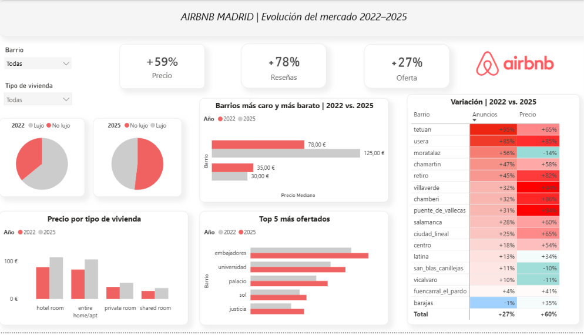

# Madrid-Airbnb-Market-Analysis-Comparative
# Airbnb Madrid | Market Analysis 2022–2025

## Project Overview

A Power BI project analyzing the Airbnb market in Madrid, comparing 2022 and 2025 through key indicators related to pricing, listing supply and review activity.

This repository includes the original dashboard developed as part of my Data Analytics Bootcamp and a redesigned version created as a personal improvement project.

## Dashboard Redesign

The redesigned dashboard focuses on improving the visual experience while retaining the original project's analytical foundations.

### Key improvements

- Updated visual identity and color palette.
- Improved layout and information hierarchy.
- More consistent data visualization and formatting.
- Refined KPI presentation.
- Improved readability and dashboard composition.

## Original Dashboard

The initial version developed during my Data Analytics Bootcamp.

## Project Analysis

The dashboard explores:

- **Price:** Median listing prices and comparisons across neighbourhoods and accommodation types.
- **Review activity:** Number of reviews and monthly review activity as indicators of platform engagement.
- **Supply:** Number of Airbnb listings and their distribution across neighbourhoods.
- **Time comparison:** Differences between 2022 and 2025.

## Tools & Technologies

- Power BI
- DAX
- Data visualization
- Data analysis

## Project Reflection

This redesign was an opportunity to revisit an earlier project, apply what I have learned since its creation and demonstrate my progress in data visualization and dashboard design.

Same project, a new perspective, and always room for improvement.

## Technical Scope & Disclaimer

This project was initially developed as an academic exercise during my Data Analytics Bootcamp. Its primary focus was on data analysis, KPI development and Power BI dashboard design.

The semantic model retains a simplified structure based on a consolidated dataset, rather than implementing a more advanced data architecture or a fully normalized data model.

The redesign focuses primarily on improving data visualization, information hierarchy and the overall user experience, while preserving the original analytical approach.

Additionally, review-related metrics are used as proxies for platform activity and should not be interpreted as direct measures of bookings or actual market demand.

This project is intended as a learning and portfolio exercise, not as a production-ready BI solution.
